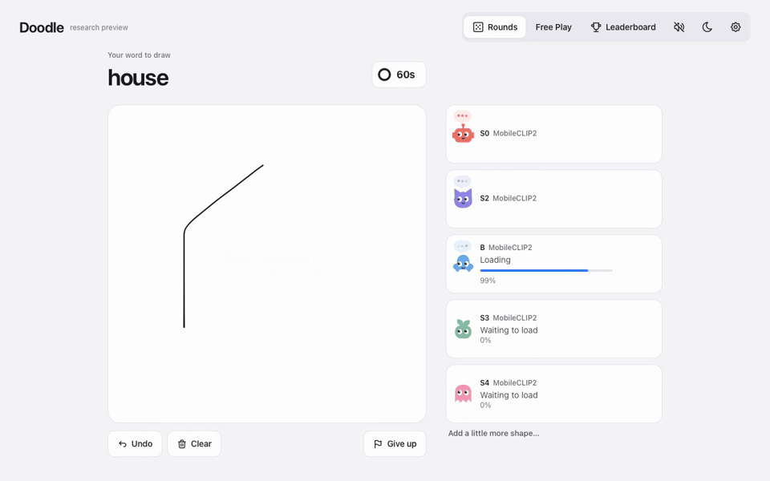
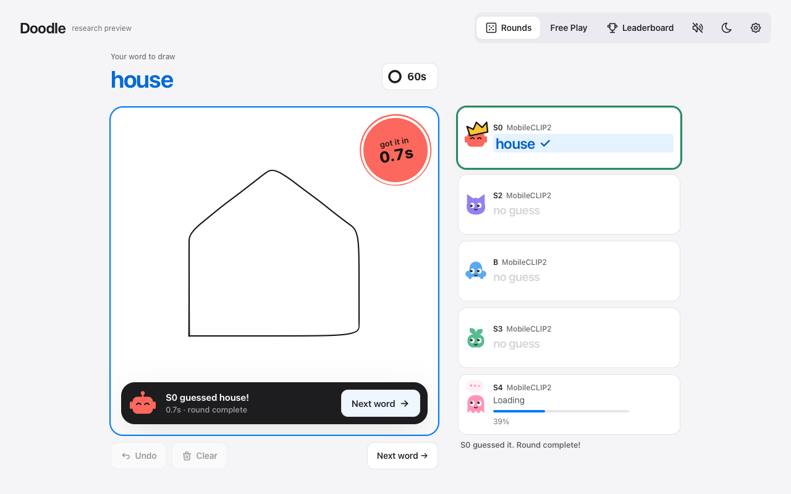

<div align="center">

# Doodle
### Research Preview

**Testing Apple’s MobileCLIP2 models on hand-drawn sketches.**

Compare five models with recognition running locally in your browser.

**[Open the research preview](https://golps.github.io/DoodleResearchPreview/)**

</div>



*An illustrative successful round with a fixed prompt and actual local inference. S0’s optional sketch assist is enabled. This is not an accuracy or speed benchmark.*

## A canvas for research

Doodle explores sketch recognition through a drawing game. A sketch begins as a few lines and gradually becomes a recognizable subject. Each animated character represents a distinct Apple MobileCLIP2 image encoder, providing a way to observe differences in recognition, response time, and the demands of running models on a personal device.

The research questions are practical: How do models respond to incomplete shapes? What changes when a larger model looks at the same image? How much vocabulary can we make available without sending each drawing to a server?

**The models run locally.** Drawings are not sent to a hosted inference service. No API key, subscription, or account is required to run inference. The host serves static files; the browser does the recognition.

## Start drawing

1. Let the first model load, then choose **Start drawing**. On desktop, other models can join as they become ready.
2. In **Rounds**, draw the familiar word shown above the canvas. The 60-second timer starts with your first stroke. **Clear** erases the drawing without restarting the round.
3. In **Free Play**, type and select a subject from the broader word bank, choose **Next**, and draw it. Synonyms share answer groups where configured.
4. A matching guess highlights the answer and ends the round immediately. Choose **Next** to continue.
5. Open **Settings → Testing** to compare model results against a captured drawing. The image and its ranked matches are kept together. Use the S0 sketch-assist switch for a comparison without that additional readout.

On phones and tablets, **S0 loads first** so you can start drawing right away, and S2, B and S3 follow on their own. S4 is desktop only: all five together need about 620 MB, which crashed iPhone Safari, and the four together need about 290 MB. The first visit downloads about 270 MB more, so use Wi‑Fi. All four run on the graphics chip. They release their scratch memory after every guess, so graphics memory stays close to the size of the models, and the drawing pad never uses the graphics chip, so a graphics reset can't wipe your strokes. On a computer, all five run on the graphics chip and load in order. The next model downloads in the background while the current one prepares.

Address options:
- `?ask=1` loads only S0 on a phone until you tap another bot.
- `?s4=1` brings S4 back on a phone or tablet, for testing only.
- `?all=1` loads all models even after crashes switched this tab to one model at a time.
- `?single=1` loads one model at a time; switch by tapping a model card.
- `?mem=1` shows a live readout of the memory the models use.
- `?cpu=s3,s4` runs the listed models on the processor.

[`probe.html`](https://golps.github.io/DoodleResearchPreview/probe.html) measures how much graphics memory the browser lets one page use. It fills memory in steps until the browser stops it. Reopen it afterwards to see the number.

If Safari resets graphics memory, the bots restart from the on-device copy and the largest active bot pauses. Your drawing is redrawn. If the whole page reloads while models are loading, the next visit in that tab skips S4 (tap it to try anyway). After a second reload, it switches to one model at a time.

Bots don't repeat a word within a round. If you pause for about two seconds, each bot may offer up to two runner-up words that scored close to its first pick.

## Five views of the same sketch

| Model | What it adds to the comparison |
| :--- | :--- |
| **S0** | The smallest encoder and recommended starting point on phones. Optional sketch assistance in Rounds. |
| **S2** | A larger efficient encoder to compare with S0. |
| **B** | A base vision transformer with a different architecture from the S-series. |
| **S3** | A larger efficient encoder with a wider embedding representation. |
| **S4** | The largest S-series encoder in this preview, with substantial memory requirements. |

These are **MobileCLIP2 image–text models**, not Apple’s Foundation Models framework. Bigger does not guarantee a better result on an individual doodle.

The current word bank contains **14,507 recognition concepts**, **8,909 configured aliases**, and **231 familiar round prompts**. The models rank this prepared vocabulary. They do not generate unrestricted descriptions, and adding a word does not guarantee it will be recognized reliably.



## Reading the results

Each model independently compares the drawing with its matching text representations. Similarity scores describe relative matches; **they are not probabilities or calibrated confidence estimates**. Bots’ thinking phrases, expressions, and timing are interface animations and do not expose internal reasoning.

S0’s optional assistance uses a project-fitted sketch readout over frozen Apple features. It is enabled in Rounds by default. Disable it in Testing to compare native image–text matching. The other models use image–text matching, and Free Play uses the broad word bank.

This preview supports exploration of sketch-based retrieval, interactive learning, and creative interfaces. Game outcomes alone do not validate those applications or establish a scientific ranking of the models.

## Practical limits

- **Memory:** Model weights stay in 8-bit form while running, so all five models use roughly 0.7 to 0.9 GB. Nearly all of it is graphics memory, compared with several gigabytes in earlier builds. Safari may still reload the page on devices with little free memory. Releasing a model session does not guarantee the browser immediately returns all memory to the operating system.
- **Loading:** Model and vocabulary files are large. A first visit may take time, particularly on a slow connection. Files are cached when browser storage allows; storage can be evicted or unavailable.
- **Browser support:** Development focuses on Macs, iPhones, and iPads. WebGPU is preferred when compatible; WebAssembly is the fallback. Feature support, latency, and stability vary by browser and device. Mobile browser emulation is not proof of physical-device reliability.
- **Recognition:** Unfinished drawings, unusual concepts, handwriting, abstraction, and ambiguous shapes can produce incorrect guesses. Recognition is limited to the prepared vocabulary and alias groups.
- **Sound:** Game effects stop when the page is backgrounded. On iPhone, Silent mode may mute them. The preview does not promise to bypass Silent mode without system media controls.
- **Measurement:** This is an exploratory research interface, not a calibrated benchmark. The README animation demonstrates one successful round with sketch assistance; it is not representative performance evidence.

## About this repository

This repository contains **the compiled browser build**, its model and vocabulary assets, documentation, demonstration media, and applicable notices. Source workspaces, preparation tools, local evaluations, credentials, private notes, and source maps are excluded.

To inspect the build locally, clone it into the default `DoodleResearchPreview` directory and serve its parent directory:

```sh
git clone https://github.com/Golps/DoodleResearchPreview.git
python3 -m http.server 8000 --bind 127.0.0.1
```

Open **http://localhost:8000/DoodleResearchPreview/**. Keep the repository folder name: the compiled asset paths use that base path. Model loading requires a compatible browser; the local server performs no inference.

## Research terms and acknowledgments

Made possible by Apple’s publicly released MobileCLIP2 models. This is an independent project, without Apple endorsement.

**Apple Machine Learning Research Model is licensed under the Apple Machine Learning Research Model License Agreement.** The model agreement limits use to qualifying non-commercial scientific research and excludes commercial exploitation and product development. The complete [Apple model agreement](licenses/Apple-AMLR.txt) controls model use; [model notes](licenses/MODEL-NOTES.txt) describe the browser adaptations and provenance.

Project-owned interface material is provided under the [Doodle Research Preview License](LICENSE). React, Motion, ONNX Runtime Web, other software, and data retain their own terms. Their [acknowledgments and license notices](licenses/THIRD_PARTY_NOTICES.md) are included with the build.
